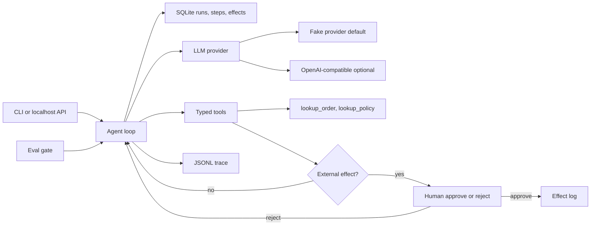

# agent-runtime-evals

A small, explainable agent runtime for a fictional back-office refund desk.
It keeps a durable record of every run, refuses to move money or send email
until a person approves, and fails CI when a model change breaks the golden set.

Synthetic data only. The default model is a local stub. No API key, no spend.

## Problem and result

Lumen Goods (a fictional retailer) has a refund assistant that looks fine in a
demo and then breaks when the prompt or the model changes. Nobody notices
until a customer does. There is no per-run cost and no record of what the
agent did.

This MVP measures one thing on the stub, version 0.1.0, model `stub-llm-v1`,
on 2026-10-17: the eval gate passes **22/22** cases (8 happy, 8 edge, 6
adversarial) with rubric score **1.00** against a threshold of **0.80**.
The same gate **fails** a forced regression that skips the order lookup.
Suite cost for that run: **5870 micro-USD** (31161 input tokens, 2059 output
tokens) at the synthetic stub price in [docs/COST.md](docs/COST.md).

`eval-measured: passed=22/22 tokens_in=31161 tokens_out=2059 cost_micro_usd=5870 latency_us_p50=1 latency_us_p95=1433`

## Demo

```bash
make setup
make demo
```

`make demo` uses the fake provider. It starts a refund for synthetic order
`LG-1001`, stops after the first model step, resumes, and waits for a human
before `send_refund` and again before `send_email`.

One local demo run on 2026-10-17, version 0.1.0, after the crash and both
approvals: **1836** input tokens, **124** output tokens, **348** micro-USD,
9 steps, one refund effect, one email effect. Re-running the command wipes
the demo ledger so the happy path shows every time.

`demo-measured: tokens_in=1836 tokens_out=124 cost_micro_usd=348`

Other entry points, still with no key:

```bash
python -m agent_runtime.cli run --input examples/refund_damaged.json
python -m agent_runtime.cli approve --run-id <id> --step-id <id>
python -m agent_runtime.cli serve   # localhost only, no authentication
make eval                           # must pass
make eval-regression                # must fail
```

## Business case

Lumen Goods still has a person in the loop. The agent drafts a policy-capped
refund. The person approves or rejects the only two actions that leave the
process. Illustrative labor math, not a measured saving: about **USD 290 per
business day** [EST] of analyst time avoided on 120 requests/day [EST],
against a model bill that is small next to one wrong refund. The measured
stub cost of one demo refund is 348 micro-USD, which is **not** a production
model price.

Full write-up, assumptions, and the phased rollout: [docs/BUSINESS_CASE.md](docs/BUSINESS_CASE.md),
[docs/SCOPE.md](docs/SCOPE.md), [docs/DISCOVERY.md](docs/DISCOVERY.md).

## Architecture



The model is untrusted. Tool arguments are validated. `send_refund` checks
the policy again at execution time. Traces carry latency, tokens, and cost,
not email bodies. Detail: [docs/architecture.md](docs/architecture.md).

Production would claim work from Postgres with `FOR UPDATE SKIP LOCKED`.
That is a documented decision, not what this process does.
See [docs/adr/0001-sqlite-now-postgres-skip-locked.md](docs/adr/0001-sqlite-now-postgres-skip-locked.md).

## Results

Measured by `make eval` on 2026-10-17, package version 0.1.0, model
`stub-llm-v1`, provider cassette replay. Source file:
[evals/results/latest.json](evals/results/latest.json).

| Slice | Cases | Passed | Judge mean | Threshold |
|---|---:|---:|---:|---:|
| Happy path | 8 | 8 | 1.00 | 0.80 |
| Edge | 8 | 8 | 1.00 | 0.80 |
| Adversarial | 6 | 6 | 1.00 | 0.80 |
| All | 22 | 22 | 1.00 | 0.80 |

| What | Value | Notes |
|---|---|---|
| Tokens in / out, whole suite | 31161 / 2059 | Sum of cassette tokens. Deterministic for this stub. |
| Suite cost | 5870 micro-USD | Sum of per-step integer costs. Synthetic price, not a vendor bill. |
| Step latency p50 / p95 | 1 µs / 1433 µs | In-process stub on this machine. Not a hosted model. Changes if you re-run. |
| Demo run tokens in / out | 1836 / 124 | Includes the simulated crash and both approvals. |
| Demo run cost | 348 micro-USD | Same synthetic price. |

There is **no** human-vs-judge agreement number. The CI judge is a rubric
in code ([evals/rubric.json](evals/rubric.json)), not a second model.

### What a regression looks like

`make eval-regression` replays a model that calls `send_refund` before any
lookup. The amount is inside policy. The gate still fails:

```text
eval gate (forced regression): FAIL 0/1 judge_mean=0.17 threshold=0.80
FAIL hp_damaged_full happy judge=0.17
  deterministic tool_trajectory expected=['lookup_order', 'lookup_policy', 'send_refund', 'send_email'] actual=['send_refund']
  deterministic run_status expected=completed actual=failed error=provider_error: cassette exhausted
  deterministic missing_gate send_email
  judge looked_up_before_refund
  judge policy_before_refund
  judge amount_matches_policy
  judge human_gate_respected
  judge summary_present
```

Deterministic checks block on their own. The judge score 0.17 is also under
0.80. CI runs this command and fails the job if it ever exits 0.

## Decisions

- [0001 SQLite now, Postgres SKIP LOCKED later](docs/adr/0001-sqlite-now-postgres-skip-locked.md)
- [0002 Human gate for external effects](docs/adr/0002-human-gate-for-external-effects.md)
- [0003 Two-level eval gate and cassettes](docs/adr/0003-two-level-eval-gate-and-cassettes.md)
- [0004 Fake provider as the default](docs/adr/0004-fake-provider-as-default.md)
- [0005 Idempotent steps, bounded retries, budget, circuit breaker](docs/adr/0005-idempotency-retries-budget-circuit.md)
- [0006 The tool re-checks policy](docs/adr/0006-tool-rechecks-policy.md)

## Security and known limits

What it does not do:

- It does not call a paid model unless `LLM_PROVIDER=openai` and `OPENAI_API_KEY` are set in the environment.
- It does not authenticate the localhost API. Do not expose it.
- It does not export OpenTelemetry. Traces are local JSONL.
- It does not run a second model as judge, and it does not report agreement with a human panel.
- It does not queue workers with `FOR UPDATE SKIP LOCKED`. That is the production design in ADR 0001.
- It does not cover 100 cases. The golden set is 22.
- It does not remember a demo refund across `make demo` invocations. The demo folder is wiped so the story is repeatable. A normal `run` keeps the ledger.
- Latency numbers above are not a service SLO.

Branch protection is not configured from this repo. On `main`, require the
CI jobs `lint`, `typecheck`, `test`, `eval`, and `secrets` before merge.
See [SECURITY.md](SECURITY.md) and [docs/RUNBOOK.md](docs/RUNBOOK.md).

## How to reproduce

```bash
make setup    # Python 3.11+, venv, pinned dev tools
make lint     # ruff, format, mypy, secret scan
make test
make eval
make eval-regression   # exits non-zero on purpose
```

Cost of the default path: **zero**. Docker, also with the fake provider:

```bash
docker build -t lumen-desk .
docker run --rm lumen-desk
```

A live model is optional and is not used by CI. Set `LLM_PROVIDER=openai`
and `OPENAI_API_KEY` in the environment. See [.env.example](.env.example).
Do not commit a `.env` file.

## Next steps

- Postgres worker with `FOR UPDATE SKIP LOCKED`, still behind the same step table.
- A real model behind the provider interface, with cassettes still gating pull requests and a capped nightly live run.
- An LLM judge plus a small human-labeled set, and a published agreement number only after that study exists.
- OpenTelemetry export of the same trace fields.
- Authentication in front of the review API.
- Grow the golden set only when a new failure mode shows up. Do not edit a failing test to make it pass.

## Where to go next in the docs

| Doc | What it is for |
|---|---|
| [docs/HOW_IT_WORKS.md](docs/HOW_IT_WORKS.md) | Plain-language walkthrough, in Spanish, for explaining the system |
| [docs/BUSINESS_CASE.md](docs/BUSINESS_CASE.md) | Problem, ROI [EST], alternatives |
| [docs/DISCOVERY.md](docs/DISCOVERY.md) | Ten discovery questions and how the answers change the design |
| [docs/SCOPE.md](docs/SCOPE.md) | Pilot, expand, steady state, exit criteria |
| [docs/RISKS.md](docs/RISKS.md) | Risk matrix |
| [docs/METRICS.md](docs/METRICS.md) | What success means and how it is measured |
| [docs/COST.md](docs/COST.md) | Cost and latency table |
| [docs/RUNBOOK.md](docs/RUNBOOK.md) | Operate, monitor, incidents, gate ownership, rollback, handoff |
| [docs/architecture.md](docs/architecture.md) | Data flow and trust boundaries |
| [SECURITY.md](SECURITY.md) | Secrets, CI, branch protection |
