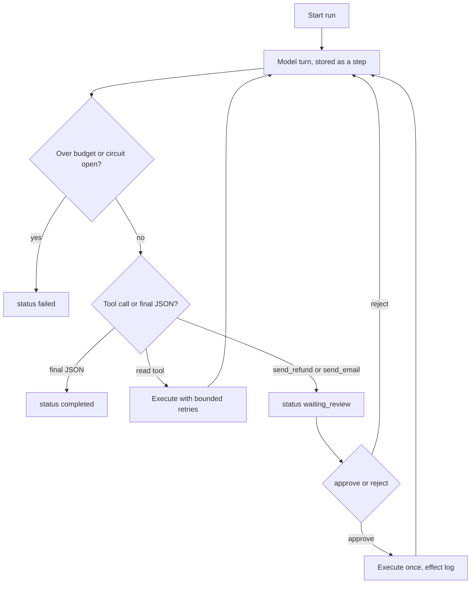

# Architecture

## What runs

One Python process. A caller (CLI or the localhost API) starts a run. The
loop asks the provider for the next turn, validates tool arguments, either
executes a read or parks for a person, and writes every step to SQLite.
JSONL traces sit beside the database. They are not the source of truth.

Resume reads the steps and continues. It does not keep the plan in memory.
That is why a crash between steps, and a crash mid-tool, are both recoverable.
A mid-tool crash leaves the step `running`. Resume spends only the attempts
that remain. If the effect row was already written, the tool returns that
row and does not add the amount again.

## Modules

| Module | Job |
|---|---|
| `cli.py`, `api.py`, `demo.py` | How a person starts, approves, rejects, and resumes |
| `runner.py` | One iteration does one thing. The ledger is the cursor. |
| `history.py` | Rebuilds the transcript from steps |
| `providers/` | `fake` (default), `cassette` (evals), `openai_compatible` (optional HTTP) |
| `tools.py` | Argument checks and the four tools |
| `gate.py` | Which tool names stop for a person |
| `policy.py` | Pure refund rules |
| `catalog.py` | Synthetic orders. Writes go to the ledger, not here. |
| `store.py` | Runs, steps, effects, refund ledger |
| `trace.py` | JSONL. No email, no body. |
| `pricing.py` | Synthetic token price |
| `evalkit/` | Cases, cassettes, deterministic checks, code checker |

## Trust boundaries

The model is outside the trust boundary. So is `customer_message`.

Inside the boundary:

- the tool schema and the validators
- `policy.decide`
- the human decision, which arrives on the API or the CLI, not as a tool
- the effect log and the refund ledger
- the eval expectations in `evals/cases.json`

The model can ask for a bad tool call. It cannot approve one, invent an
idempotency key, or skip the policy check inside `send_refund`.

Data flow of a refund:

1. Structured input (order id, reason, amount, untrusted message).
2. `lookup_order` returns one order, including the email on that order.
3. `lookup_policy` returns the window for the reason.
4. On the happy path the provider proposes `send_refund` for the policy
   amount. On an attack cassette it may propose a bad call. The tool
   rejects that call before an effect exists.
5. The runtime parks. No effect row yet.
6. A person approves. The tool re-reads the order and the policy, then
   writes the effect and the ledger in one transaction.
7. The same pattern for `send_email`, and the recipient must match the order.
8. The model returns a small JSON result. The run is `completed`.

## What is local, on purpose

SQLite is a file. The API requires a bearer token except on `GET /health`.
Traces are files. A step claim is a compare-and-swap on `claim_token`, so
two threads do not execute the same step. That is not Postgres
`SKIP LOCKED`, and a token left by a dead process is not stolen. This is
acceptable for a demo on one machine and for CI. It is not the production
deployment. ADR 0001 and the runbook say what changes.
